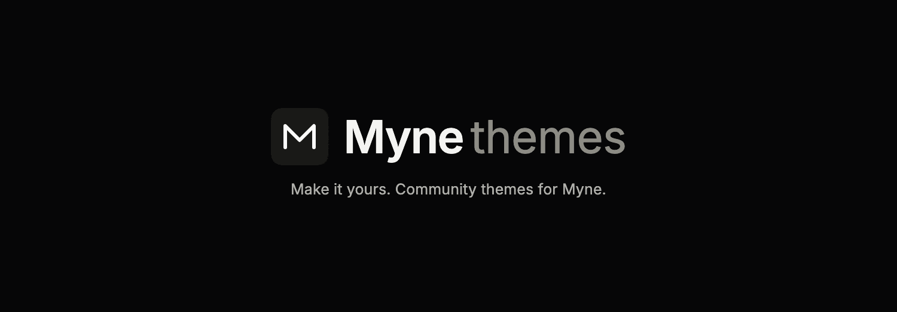

<p align="center"></p>

# Myne themes

> Make it yours. Community themes for Myne.

The community **theme marketplace** for [Myne](https://github.com/myne-md/myne) —
an end-to-end-encrypted, local-first markdown notes app with optional
zero-knowledge sync. The per-client custom-theme *engine* already ships in the
desktop app (Settings → Appearance → Custom themes); this repository is the
*distribution* side: a place to **browse, share, and install** community themes.
Browse the gallery at **[myne.md/themes](https://myne.md/themes)**.

A Myne theme is **not CSS** — it is a small, validated `.json` map of design
tokens → color values. Every value passes an **allowlist** (hex / `rgb|hsl(…)` /
bare keyword / `<number><unit>` only), which is what makes installing a stranger's
theme safe: the worst a bad file can do is fail to import. That validator is the
**same code the desktop client runs** — this repo's CI invokes the
[`theme-validator`](https://github.com/myne-md/myne/tree/develop/theme-validator)
crate from the main repo, so the marketplace can never host a theme the app would
reject. Themes are **validated on your device, never sandboxed** — we never claim
a theme is "safe", only that it passed validation.

This is one repo in the multi-repo [Myne](https://github.com/myne-md/myne) project
under [`myne-md`](https://github.com/myne-md): the main repo holds all three clients
(desktop, web, mobile), the shared validator crate, and the canonical specs
([`docs/`](https://github.com/myne-md/myne/tree/develop/docs)); companion repos cover the
sync server, website, ops, clipper, branding, test vectors, the adversarial range, and
tooling. Nothing here is cryptographic — a theme carries no note content and no key
material.

## How it works

- **Browse** the gallery at [myne.md/themes](https://myne.md/themes). Each theme
  shows an authentic preview (rendered by CI from the theme's own tokens — it
  can't misrepresent the theme), its author, a description, a **GitHub link**, and
  a **download link**.
- **Install** on desktop: download a theme's `theme.json`, then open Myne →
  Settings → Appearance → **Import theme**. The app re-validates it, derives a
  safe name, and applies it. A custom theme is **vault content**, not a
  device-local setting: the palette is sealed into the encrypted `vault.themes`
  blob under the vault key, so it syncs to the vault's other devices and travels
  in a backup. Import a theme once and it is on every device that unlocks that
  vault (main repo `docs/threat-model.md`, "Custom-theme CSS-value surface").
- **No app calls, no tracking.** The app never phones the marketplace — you
  download in your browser and import a local file. There is no in-app store, no
  telemetry, and no download counters.

## Contributing a theme

One theme = one folder = one pull request:

```
themes/<slug>/
├── theme.json     # the validated palette
└── meta.json      # { name, author, description, license: "CC-BY-4.0" }
```

Previews are generated by CI — don't add your own screenshot. Validate locally
first (`cargo run -p theme-validator --bin validate -- themes/<slug>/theme.json`),
then open a PR and complete the checklist + DCO line. A maintainer reviews for the
things automation can't judge (semantic-color deception, quality, licensing) and
merges. Full guide: **[CONTRIBUTING.md](CONTRIBUTING.md)**. Governance and the
takedown policy: **[GOVERNANCE.md](GOVERNANCE.md)**.

## Status

**Live, pre-alpha.** The repository is stood up and serving: the community themes under
`themes/`, the contribution flow ([`CONTRIBUTING.md`](CONTRIBUTING.md) plus
[`GOVERNANCE.md`](GOVERNANCE.md)), the CI hard-gate (the real `theme-validator` crate from the
main repo, which carries both the value allowlist and the WCAG contrast floors, plus a
metadata/license lint), the gallery build (`tools/build-index.mjs` plus CI-rendered previews),
and the `myne.md/themes` section on the website.

Adding a theme is one theme = one folder = one pull request; see
[`CONTRIBUTING.md`](CONTRIBUTING.md) to submit one.

## License

Dual-licensed by subtree (see [`LICENSING.md`](LICENSING.md)):

- **Original themes** (`themes/**`) — [CC-BY-4.0](LICENSE-THEMES) by default. Free
  to use and adapt with attribution (the gallery credits each author).
- **Ported themes** — keep their **upstream license** (declared per-theme in
  `meta.json`, usually MIT) and credit the original author. Ports are redistributed,
  not relicensed.
- **Tooling** (CI, lints, generators) — [AGPL-3.0](LICENSE-TOOLING), matching the
  Myne application code.
